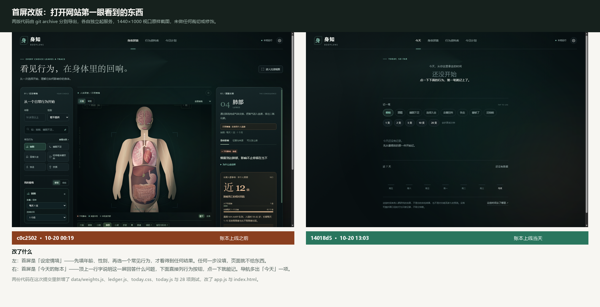

# 今天的账本 · Prompt 链记录

- 日期：2026-10-20
- 对应提交：`3d3e8ff`（数据层）、`14018d5`（首屏界面）
- 验证：`npm test` 28 项全过；1440×1150 与 390×900 两档截图核对
- 截图：`docs/evidence/today-ledger/`（本次未落盘，见下方说明）

> 说明：本轮界面截图暂存在本地临时目录，未提交到仓库（`.tmpshot/` 已加入 `.gitignore`）。
> 需要作为参赛材料时，应重新生成并存到 `docs/evidence/today-ledger/`。

## 1. 初始意图（用户原文）

> 开始今天的任务吧，香港服务器是建议现在买还是

上一轮已经确定的三件事，构成本轮的隐含需求：

1. 首屏是「今天的账本」，不再是人体系探索页
2. 以**分钟**为主单位，用具体事情做类比（「一部电影」而不是「−322 分钟」）
3. 信息密度是第一验收项：一屏只能有一个焦点

## 2. 首轮实现与出问题的地方

### 2.1 数据层：先定「谁说了算」

第一轮没有直接写界面，而是先把数值的来源固定下来。原因是同一个数字会被首屏、账本、类比、将来的 AI 解读各用一次，只要有第二处地方写死数字，就一定会出现「界面说 −60、详情说 −40」的对不上。

**这一轮定下的三条规则：**

- 分钟数只存在于 `data/weights.js`，其他地方一律读取
- 记录里**不存**分钟数，只存「行为 + 数量 + 日期」，分钟由权重实时算出
- 没有可靠口径的行为返回 `null`，**不返回 0**

第三条是这一轮最关键的一处判断。返回 0 意味着「这个行为没有影响」，是一种无声的错误断言；返回 `null` 则强制调用方必须显式处理「不能折算」这种情况。

### 2.2 类比换算：第一版算错了

初版按「取比值最接近 1 的档位」实现，然后写测试断言 `160 分钟 → 将近两部电影`。测试失败，实际输出 `大约一个下午`。

核查后确认**实现是对的，测试预期是错的**：160 分钟对「两部电影」（180 分钟）的比值是 0.889，对「一个下午」（180 分钟）的比值也是 0.889——两者指向同一时长，但「一个下午」更接近中文日常说法。于是改测试而不是改实现。

同时发现一个拼接 bug：`200 分钟` 会输出「大约将近两个下午」。原因是量词和前缀被同一段模板拼接。改为四个分支各自返回完整短语。

### 2.3 首屏第一版：账本被挤出了屏幕

第一版的「记一笔」把 8 个行为全部展开，每行 4–5 个数量按钮。实测高度约 400px，导致：

- 首屏看不到「今天记了什么」
- 页面从「只回答一个问题」退化成「一个表单」

这是设计意图和实际渲染不一致的典型情况——**写的时候以为只是几行按钮，渲染出来才发现它占了半屏**。

改法：拆成两段。上面一行是行为标签（8 个 chip），点选后在下方出现该行为的数量按钮。总高度从约 400px 压到约 92px，两次点击完成录入。

### 2.4 趋势图：所有柱子一样高

第一版柱状图把「柱子 + 日期」放在同一个 flex 列里，柱子的百分比高度相对整列计算，而列里还有日期文字和间距，flex 压缩后所有柱子被压成接近的高度，比例完全失真。

改法：把柱子层和日期层拆成两个平行的 flex 行，柱子高度相对固定的柱区计算，比例才准。

### 2.5 移动端的一次误判

390px 截图看起来内容被右侧裁切，怀疑横向溢出。写了一个同源 iframe 诊断页测量关键元素矩形，结果是 `.today` 宽 354px、`.log-line` 宽 354px、`body.scrollWidth` 等于 390——**没有任何溢出**，是目测缩放造成的误判。

这一步没有改任何代码，但值得记下来：**先测量再改**，否则会为了一个不存在的问题加 `overflow:hidden`，把真正的溢出藏起来。

## 3. 最终结果

- `npm test`：28 项全过（新增 18 项，覆盖等级越级、`null` 口径、跨月日期、非法记录清洗）
- 1440×1150：一屏可见今日分钟、类比、昨日对比、记一笔、今日记录、近 7 天趋势
- 390×900：无横向溢出，关键元素宽度经测量确认
- 提交拆为两次：数据层与界面层分开，便于单独回滚

## 4. 一句话复盘

这一轮真正省时间的不是写代码，是**先把「数字从哪来」固定成一个文件**。后面所有返工都发生在界面层，数据层一次没改过。

> 上面这句「一次没改过」是当时那一轮的说法。拉到今天回看，更准确的说法见 §6.3——数据层后来确实被动过 5 次，但没有一次是被界面改版逼出来的。

## 5. 尚未解决的问题

8 个行为里，只有「抽烟」有可靠的分钟折算（UCL 2024，每支 20 分钟），其余 7 项目前只能记录方向、不给分钟数。这会让账本显得单薄，是下一轮必须处理的产品问题，不是代码问题。

---

## 6. 补录：可复现对照（2026-10-29）

> **这一节不是原始 Prompt 证据。** 本轮对话发生在 10-20，而当时做的公开分享快照
> 只截了 10-21 那五轮（共 5410 字，见 [dark-to-light 归档](../dark-to-light/share-2026-10-21-raw.txt)），
> 10-20 这一段没有留痕。这里补的是另一件能自证的事：**上面描述的改动，任何人都能从 git 里把两个提交分别导出来、跑起来、自己对着看。**
> 它支撑的是「过程可复现与演进链路」这一项，不是「原始 Prompt 留痕」那一项。

### 6.1 首屏对照



左边是账本上线前一个提交（`c0c2502`），右边是上线当天的 `14018d5`。两版各自独立起服务、1440×1000 视口原样截图，没有裁切和修饰。

左边那一版首屏是「设定情境」：先填年龄、性别，再选一个常见行为，才看得到任何结果。右边这一版把这一整套前置条件拿掉了——打开就是「还没开始」，下面直接列行为，点一下就能记。

### 6.2 怎么自己跑一遍

```bash
git archive c0c2502 | tar -x -C /tmp/before
git archive 14018d5 | tar -x -C /tmp/after
(cd /tmp/before && python3 -m http.server 4183)
(cd /tmp/after  && python3 -m http.server 4184)
# 浏览器打开 http://127.0.0.1:4183 与 http://127.0.0.1:4184
```

两个版本都是纯静态，不需要 `npm install`，也不需要服务端。
`/tmp/after` 那一版点「香烟 → 1 支」，账本上会出现「20 分钟 · 大约等于 一集短剧」。

### 6.3 用提交历史量一遍「数据层有没有被动过」

| 层 | 文件 | 被动过的提交数 |
| --- | --- | --- |
| 数据层 | `data/weights.js`、`ledger.js` | **5** |
| 界面层 | `today.js`、`today.css` | **16** |

统计范围 `14018d5..HEAD`，共 77 个提交，一条命令可复核：

```bash
git log --oneline 14018d5..HEAD -- ledger.js data/weights.js | wc -l   # 5
git log --oneline 14018d5..HEAD -- today.js today.css | wc -l          # 16
```

那 5 次分别做了什么：

| 提交 | 性质 |
| --- | --- |
| `079ec15` | 加口径：酒精、屏幕时间 |
| `e25f942` | 加关联：行为 → 器官，供粒子飞行动效读取 |
| `346c812` | 加口径：睡眠不足改成有出处的推算值 |
| `1e4ea43` | 修算法：同一行为记多次要合并成一行 |
| `f5a825b` | 修算法：去掉账本里多余的「没抽烟」行 |

**没有一次是因为界面要换个样子而被迫改数据。** 这正是 §2.1 那三条规则想要的结果：界面怎么改，数字的来源和算法都不用陪着改。
